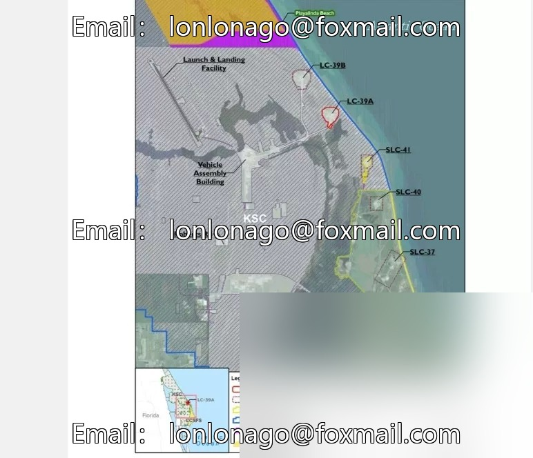
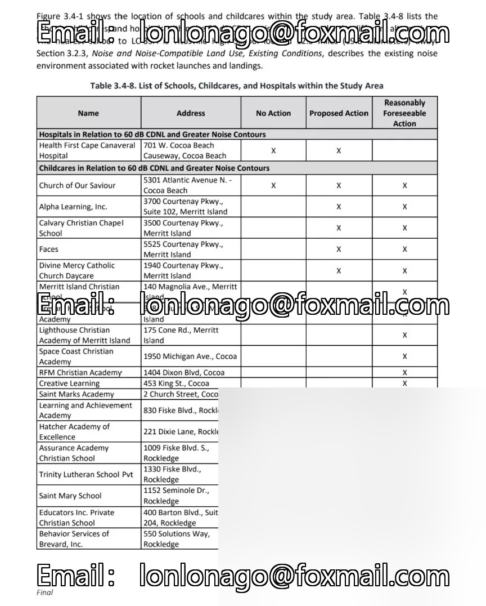
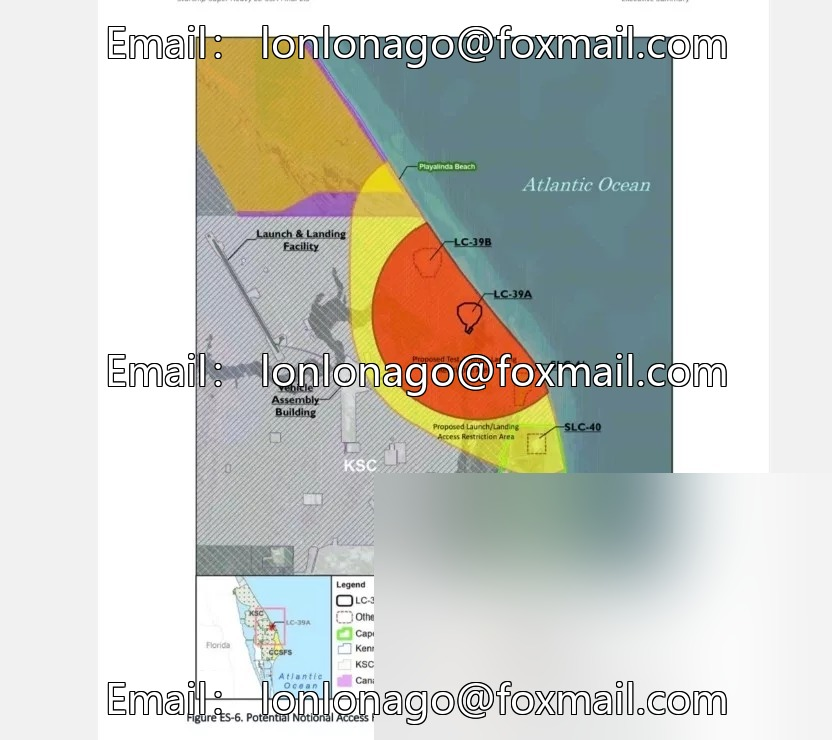

# FAA "Starship Super Heavy Rocket LC-39A Launch Site Environmental Impact Report" (electronic)

## Body

The of the FAA《Starship Superheavy Rocket LC-39A Launch Site Environmental Impact Report》, a 440-page PDF file released in January 2026. The content covers the noise impact assessment on sensitive facilities such as schools, daycares, and hospitals surrounding the starship launch, and is accompanied by maps and detailed analysis.
First Volume: Main Report (MAIN EIS)

This volume is the core of the whole report, which is divided into 8 chapters, and the standard EIS process usually includes:

1. Chapter 1 Purpose and Necessity: Explain why this project should be carried out.

Chapter 2 Proposed Actions and Alternative Plans: How SpaceX plans to do it, and which other plans they have evaluated.

Chapter 3 Affected Environments and Consequences: This is the most critical part, assessing what impact the launch activities will have on local flora and fauna, air, water quality, and other factors.

Chapter 4 Other environmental considerations: involving unavoidable impacts, resource consumption, etc.

Chapters 5-8: The main content is mostly administrative matters, such as the list of personnel, cooperating institutions, references, and index.

Volume II: Appendices

This portion is very extensive, providing detailed data and legal basis supporting the main report, primarily divided into four appendices:

Appendix A: Public and institutional participation: records the public notices, draft review, and received public opinions and replies during the project's initial stage.

Appendix B: Legal consultation: This section lists a large number of compliance reviews, such as the "Endangered Species Law" (targeting fish, marine mammals, etc.), the "National Historical Protection Law," etc., proving that the project complies with various environmental regulations.

Appendix C: Resource area support information: includes specific professional technical data such as noise evaluation, air quality evaluation, etc.

Appendix D: Applicable regulations for each resource field: a very detailed overview table covering detailed regulations and compliance for more than a dozen subfields, including land use, socio-economic, children's health, visual impacts, water resources, air quality, climate, hazardous waste, and others.

The document covers the FAA Environmental Impact Report for the LC-39A launch site, including noise impact assessments for sensitive facilities, spatial maps, detailed analyses, and location details. The images show specific locations and facilities such as Playalinda Beach, Atlantic Ocean, Launch & Landing, and related land use areas.

<!-- AI_ENRICHED -->

## Images

## Payment

Here is a pay link on Stripe ( https://buy.stripe.com/3cs8yP7sY87d0vu9AB ). Please contact me lonlonago@foxmail.com after funding $89, and I will send you a complete data files , thank you!

